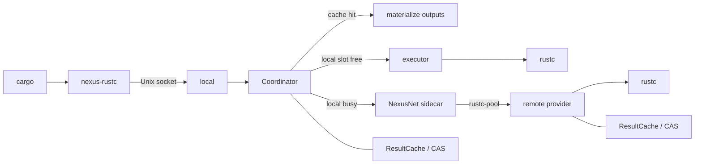

# NexusCompile

**A distributed Rust compile node for NexusNet** — intercepts cargo's rustc invocations through the local `nexus-rustc` wrapper and caches results by action digest. When local capacity is busy, it can forward compile tasks to other nodes over NexusNet.

This project is more than a NexusNet backend adapter: it implements the local wrapper, result cache, remote provider/consumer roles, and capacity-aware scheduling.

## Features

- **Local compile interception**: `nexus-rustc` acts as `RUSTC_WRAPPER`, taking over supported lib-crate builds and falling back to the real rustc for everything else.
- **Result cache**: caches outputs by action digest (toolchain, target, normalized arguments, input file hashes); outputs are stored in a SHA-256 CAS.
- **Remote compile pool**: a consumer uploads a bundle, a provider runs rustc and returns the outputs; tasks are coordinated through the CBOR `rustc-pool` v2 application protocol.
- **Capacity awareness**: samples CPU and memory on Linux, computes available slots, and publishes them through `Subscribe`/`CapacityUpdate`.
- **Deployment**: Debian `.deb` + systemd; paths are anchored by environment variables.

## Roles and terminology

| Term | Description |
|---|---|
| **node / backend** | This process. Listens on `127.0.0.1:<port>` and is dialed by the NexusNet node, which completes the hello handshake. |
| **wrapper** | `nexus-rustc`. cargo invokes it through `RUSTC_WRAPPER`; it forwards requests to this process over a Unix socket. |
| **provider** | The side that accepts `rustc-pool` tasks, runs rustc, and returns outputs. |
| **consumer** | The side that places tasks into the unified local/remote pool and tracks provider toolchain capabilities. |
| **task / action digest** | The normalized fingerprint of one rustc invocation (32 bytes), also used as the `TaskId`. |
| **bundle** | The manifest, sources, externs, and OUT_DIR inputs required by one remote task. |
| **slot** | One unit of compile concurrency, derived from CPU and memory. |

A single process can act as both provider and consumer.

## Architecture



- **Local path**: cargo -> `nexus-rustc` -> task socket -> bundle materialization -> `Coordinator::execute` -> cache, local rustc, or remote provider.
- **Remote path**: consumer -> NexusNet -> provider's `rustc-pool` service -> provider rustc -> outputs transferred back by SHA-256.
- **Scheduling path**: `pool/runtime.rs` samples capacity; providers broadcast `CapacityUpdate`; consumers maintain provider views through `Subscribe`/`Subscribed`.

## Quick start

### 1. Start the backend

```bash
cargo run
```

The first run creates `./config.toml` when it is missing and listens on `127.0.0.1:{port}` (default port `5100`; it must match the `host`/`port` registered in NexusNet `local_services`).

Existing configuration files are **read-only at runtime**: missing fields fall back to defaults in memory and are never written back. Invalid TOML prevents startup; unknown and legacy keys are preserved and ignored.

Complete default configuration:

```toml
port = 5100
service_name = "rustc-pool"

[node]
max_usage_percent = 80
sample_interval_secs = 1
rustc = "rustc"
toolchains = []

[subscription]
target_slots = 8
update_interval_secs = 30
ttl_secs = 60
target_reevaluate_secs = 5

[cache]
dir = ""
result_cache_mb = 512
```

### 2. Enable the local wrapper

```bash
cargo build
export CARGO_INCREMENTAL=0
export RUSTC_WRAPPER="$PWD/target/debug/nexus-rustc"
cargo build
```

`CARGO_INCREMENTAL=0` is required for the wrapper to take over compilation; calls that do not meet the requirements execute the real rustc directly. For release builds, use `target/release/nexus-rustc`.

### 3. Two-node example (optional)

Run this backend on both machines and register the local service name as `rustc-pool` in NexusNet:

```toml
[[services.dispatcher.local_services]]
name = "rustc-pool"
host = "127.0.0.1"
port = 5100
require_auth = false
```

Provider discovery is automatic through NexusNet. Both nodes must use the same
`service_name`, and NexusNet's `local_services.name` must match it. The consumer
only needs a target for remote capacity:

```toml
[subscription]
target_slots = 16
```

When the consumer exhausts its local slots, `Coordinator` tries to start a remote compile on a subscribed provider and falls back to local execution if the remote path is unavailable.

> `require_auth = false` is only suitable for localhost or trusted networks. Remote compilation executes rustc arguments and externs supplied by the submitter, so production deployments should enable NexusNet authentication and restrict peers that can reach this service.

## Configuration reference

### Top level

| Field | Default | Description |
|---|---|---|
| `port` | `5100` | Listen port; the address is always `127.0.0.1`. |
| `service_name` | `"rustc-pool"` | NexusNet service name used for discovery and peer requests. Must match `local_services.name`. |

### `[node]`

| Field | Default | Description |
|---|---|---|
| `max_usage_percent` | `80` | Upper bound on CPU and memory used by compile slots, as a percentage of total resources. |
| `sample_interval_secs` | `1` | Capacity sampling interval (seconds). |
| `rustc` | `"rustc"` | Fallback/default rustc executable used by the provider side. The Debian package points this at the base private toolchain. |
| `toolchains` | `[]` | Optional list of `{ channel, rustc, target }` entries. When non-empty, the provider selects the matching entry by `toolchain_id`. |

`cores_per_slot` and `mem_per_slot_mb` are fixed constants: `1.0` core and
`2048` MB per slot. Toolchain/target are selected automatically from the action
manifest; there are no manual labels.

### `[subscription]`

| Field | Default | Description |
|---|---|---|
| `target_slots` | `8` | Desired visible total capacity (local `max_slots` plus subscribed providers' `max_slots`). `0` disables active subscription. |
| `update_interval_secs` | `30` | `CapacityUpdate` keepalive interval; updates are also sent on this period when capacity is unchanged. |
| `ttl_secs` | `60` | Expiration time for a provider capacity view. |
| `target_reevaluate_secs` | `5` | How often visible capacity is compared with `target_slots`. |

> `target_slots` includes local capacity. If it is not greater than the local `max_slots`, no remote provider will be subscribed.

### `[cache]`

| Field | Default | Description |
|---|---|---|
| `dir` | `""` | Cache root. When empty, resolves via `NEXUSCOMPILE_CACHE` -> `$NEXUSCOMPILE_HOME/cache` -> `./cache`. |
| `result_cache_mb` | `512` | Result cache quota (MB). `0` disables the result cache while still allowing compilation. |

### Loading and upgrade behavior

- An existing `config.toml` is never rewritten by the service.
- Missing fields use defaults in memory; no implicit migration is written.
- Invalid TOML fails startup instead of renaming or replacing the file.
- The Debian package records a schema version in `/etc/<pkg>/config.schema` and runs `config-check` on install/upgrade.
- Legacy keys are ignored and preserved; they are not removed by this version.

Installer-facing commands:

```bash
NexusCompile config-defaults --config <file>   # write defaults only when missing
NexusCompile config-check    --config <file>   # parse + warnings; exit 2 on invalid TOML
```

## Local compile wrapper

`nexus-rustc` only takes over invocations that meet all of the following conditions; everything else is passed through to the real rustc:

- `CARGO_INCREMENTAL=0`;
- crate name is not `build_script_build`;
- `--crate-type` contains only `lib` or `rlib`;
- `--emit` includes `link`;
- `--out-dir` is present;
- no `--test` or `--print`;
- no incremental compilation flags (`-C incremental`).

### Execution flow

1. Compute the action digest (toolchain, target, normalized args/env, input file hashes).
2. Ask the task socket: local cache lookup first, then the remote cache table recorded from earlier remote results.
3. On a hit, download the outputs over the task socket and write them into `--out-dir`.
4. On a miss, wait briefly for any `--extern` sibling (`.rmeta` ↔ `.rlib`), build the bundle, and upload it (`Start` carries `toolchain_id` and `target`).
5. The backend decodes and materializes the bundle only when a slot is assigned, runs rustc, and returns the outputs; the wrapper writes them into `--out-dir`.

The wrapper replays the local result to cargo as stdout/stderr and an exit code. If the node is offline, the invocation is unsupported, or infrastructure fails, the wrapper `exec`s the real rustc.

### Socket path

The wrapper uses only the task socket:

1. `NEXUSCOMPILE_TASK_SOCKET`;
2. `<NEXUSCOMPILE_SOCKET parent>/task.sock`;
3. `$XDG_RUNTIME_DIR/nexus-compile-task.sock`;
4. `/tmp/nexus-compile-<user>-task.sock`.

The task socket permission is `0660` (group read/write). Under systemd it is
placed at `/run/<pkg>/task.sock` with group `nexusnet`, so users in that group
can connect without sharing the service account. `NEXUSCOMPILE_SOCKET` remains
as a compatibility path base; the legacy `nexus.sock` server has been removed.

### Cache behavior

- The cache is partitioned by action digest; outputs are stored by SHA-256 content address in the CAS.
- Result TTL is fixed at 24 hours; a lookup renews the entry at the moment it hits, and the TTL resets after a restart.
- A lookup is the only read path: it drops expired entries while it scans, validates that the blobs still exist, and returns the output list. Hits never materialize into the build directory.
- Upstream artifacts are keyed by the task id that produced them: `nexus-rustc` writes `<artifact>.nexus` next to each output, and a later manifest uses that id instead of the file content. This keeps digests independent of the staging directory and the target path.
- Eviction runs in a background thread every 60 seconds and reclaims the least recently used entries. There is no pinning: an in-flight download does not protect its entry.
- The cache is local only and is not shared across nodes. The consumer keeps an in-memory location hint for remote providers that successfully served a digest; a later `FetchCached` asks that provider for the result, and a failure removes the hint before falling back to the compile pool.
- If the cache cannot be opened, it degrades to disabled; if local execution fails, the wrapper falls back to the real rustc.

## Distributed compile pool

### Task lifecycle

```text
try local result cache
  -> FetchCached (remote location hint; no slot)
       -> Cached -> BlobGet outputs -> ResultAck
       -> miss/failure -> remove hint -> shared FIFO task queue
  -> scheduler wakes, pulls tasks in order
       -> LocalOrigin: local slot -> remote overflow
            -> remote failure -> queue tail
       -> RemoteOrigin: local slot only
            -> local unavailable -> task failed
  -> Reserve
       -> BlobPut (upload the bundle in 1 MiB chunks)
       -> TaskReady
       -> task enters the queue and remains Queued
       -> scheduler assigns a local slot and runs rustc
       -> consumer polls Status
       -> BlobGet (download outputs in 1 MiB chunks)
       -> verify SHA-256 and write to the local cache
       -> ResultAck
```

- Local and remote ingress share one ordered FIFO queue and one scheduler.
- Local admission happens inside the scheduler loop, before a task is spawned:
  `reserve` is synchronous there, so a batch of queued tasks cannot overdraw the
  same `free_slots` snapshot. A local task that finds no local slot falls back to
  a remote provider; if none accepts, it goes back to the queue tail and the loop
  waits 100ms. A local task whose toolchain is not available on this node is
  rejected immediately so the wrapper runs the real rustc.
- Remote ingress is admitted at `Reserve` time: a full provider answers `Busy`
  before any bundle is uploaded, and the consumer tries another provider.
- Local resources and remote reservations remain two separate statistics:
  - local: `Provider.available_slots() = free_slots - active_slots`;
  - remote: `Consumer.ProviderView.free_slots/capabilities`.
- `TaskReady` returning `Ack` means the task was validated and enqueued; it does not mean execution has started.
- `TaskId` is the action digest (32 bytes); the same digest maps to the same task.
- `Reserve` accepts only `slots = 1` and returns:
  - `Granted`: a new task, or an already queued/running task with its lease;
  - `Busy`: no local slot is available;
  - `Rejected`: the request is invalid.
- By default, the consumer polls `Status` once per second with an overall timeout of 30 minutes.
- `Done` returns the `OutputRef` list; the consumer downloads each chunk, verifies hashes, and writes to its local CAS/cache.
- Every `Reserve` that returns a result creates a lease. `ResultAck` removes the task directory when the last lease is gone and deletes the `TaskEntry`. The provider result cache remains available for later hits.
- `FetchCached` is the cache-query request: it checks only the provider result cache, validates the blobs, renews the entry, and returns `Cached` with a lease. It does not create a `TaskEntry` or consume a slot.
- `Reserve` never consults the cache; `Status` reports only the task entry.
- `Cancel` marks the task `Cancelled` and frees the slot.

`Reserve` only reserves a slot and creates a lease; it does not inspect the task. The backend checks the bundle file hash and enqueues it, then performs the full review when a slot is assigned:

1. verifies that the bundle file hash equals `Reserve.input_manifest`;
2. reviews the invocation shape and recomputes the manifest digest against `TaskId`;
3. resolves the requested `toolchain_id` and `target` once;
4. materializes bundle files and substitutes `<MANIFEST>`, `<OUT>`, and `<EXTERN>` placeholders;
5. runs the resolved rustc and collects outputs under `OUT_DIR`;
6. writes the local cache and marks the task `Done`.

If `TaskReady` review fails, the provider fails the task, removes the bundle directory, and the consumer may try another provider.

### Capacity and subscriptions

- On Linux, reads `/proc/stat` and `/proc/meminfo`; CPU usage uses an EWMA (0.3 new value + 0.7 previous value).
- `max_slots = floor(total * max_usage_percent)` for CPU and memory, using fixed 1.0 core / 2048 MB slots.
- `free_slots` is the remaining headroom under the percentage cap; it is not reduced by active tasks because `/proc` usage already includes them.
- Local admission uses `available_slots = free_slots - active_slots`; this prevents the shared queue from oversubscribing one sampling window.
- Providers send `CapacityUpdate` to subscribers; `seq` is monotonically increasing and older sequence numbers are ignored.
- Consumers build provider views through `Subscribe`/`Subscribed` and drop a provider if no update arrives within `ttl_secs`.
- Providers are discovered automatically through NexusNet `discover_providers`. Discovery runs only when capacity is insufficient: every 30 seconds when visible capacity is zero or the last discovery failed, otherwise every 1 hour. A provider view that expires counts as an abnormal result, so a dropped peer triggers rediscovery within seconds instead of waiting for the hourly interval.

### Cache and CAS

- `ResultCache` lives at `<cache>/actions/<digest>/manifest.cbor` and records the output list.
- Output blobs live at `<cache>/blobs/<sha256>`; writes use a temporary file plus rename, and materialization verifies the hash again.
- Compile staging lives at `<cache>/staging/`; provider task bundles and work dirs live at `<cache>/work/<digest>/`.
- The quota is controlled by `result_cache_mb`; a background thread checks every 60 seconds and reclaims the oldest entries first.
- Entries are renewed on every cache hit; expired entries are removed while a lookup runs. There is no pinning: eviction and expiry do not wait for in-flight downloads.

## Toolchain identity

- A rustc identity is `SHA-256(rustc -vV output || target)`.
- `target` is the configured target; an empty target means a host build.
- Capability broadcasts use that same string for both the id and the advertised target, so a client requirement computed from the same string matches.
- The hash covers the whole `-vV` output, so peers must run the same toolchain build — the same commit hash and LLVM version, not merely the same release number.

## Diagnostics

- `NEXUSCOMPILE_WRAPPER_DEBUG` — print the wrapper's fallback reason to stderr.
- `NEXUSCOMPILE_SCAN_LOG=<file>` — append dependency scan results, per-file hashes at manifest and bundle time, wrapper fallback reasons, and the decoded manifest of each task that starts executing.

## Known limits

- Remote bundles travel as `service_request` messages. A NexusNet node with a small `max_request_bytes` rejects large bundles (observed around 2 MB); newer NexusNet releases raise this limit.
- Invocations that are not `lib`/`rlib` (proc-macros, bin targets, build scripts) always run through the real rustc, so their artifacts carry no task id and dependents fall back to content hashing.

## NexusNet integration

Register this backend's service name as `rustc-pool` (or the configured `service_name`) in NexusNet; remote calls use that name:

```toml
[[services.dispatcher.local_services]]
name = "rustc-pool"
host = "127.0.0.1"
port = 5100
require_auth = false
```

- Both nodes must run this backend and use the same `service_name`.
- Providers are discovered automatically; there is no static peer list.
- Providers advertise toolchain capabilities in `Subscribed`; consumers prefer providers whose `toolchain_id` and `target` match. The final authority is the provider's review after the complete bundle arrives.
- Production deployments should enable NexusNet authentication and allow only trusted peers to reach this service.

## Protocol

### sidecar v2

#### Framing

```text
u32_be(len) || cbor(message)      # len <= 16 MiB
```

The first frame in both directions must be `hello`; incompatible versions are disconnected. The current `PROTOCOL_VERSION = 2`.

#### Messages

Messages are discriminated by the text field `t`:

| `t` | Direction | Description |
|---|---|---|
| `hello` | both | Handshake and version negotiation |
| `request` | node -> backend | Forward an inbound service request `{ id, service, payload }` |
| `reply` | both | Correlated reply `{ id, ok, result?, error? }` |
| `list_services` | backend -> node | List global service types |
| `discover_providers` | backend -> node | Query providers for a service |
| `query_public_ip` | backend -> node | Query the node's public address |
| `whoami` | backend -> node | Query this node's identity |
| `reconnect_bootstrap` | backend -> node | Reconnect to bootstrap |
| `reannounce_services` | backend -> node | Re-announce local services |
| `reload_config` | backend -> node | Reload node configuration |
| `refresh_cache` | backend -> node | Clear application caches and non-self local Kademlia replicas |
| `relay_status` | backend -> node | Relay status |
| `pq_status` | backend -> node | Post-quantum status |
| `auth_status` | backend -> node | Authentication status |
| `query_key` | backend -> node | Read a DHT record |
| `add_key` | backend -> node | Write a DHT record / announce providing |
| `remove_key` | backend -> node | Stop announcing as a provider / remove the local record |
| `service_request` | backend -> node | Start a P2P service request (automatic provider selection) |
| `service_request_to` | backend -> node | Start a P2P service request to a specific peer |

- Correlation ids are UUIDs (encoded on the wire as a 16-byte CBOR `bstr`).
- `reply.result` is **CBOR** bytes defined per op; `add_key`'s `value` is a `bstr` and is binary-safe.
- Control commands time out after 60 seconds by default and reply with `error{code:"timeout"}`.

#### `reply.result` payloads

| op | result |
|---|---|
| `list_services` | `[* tstr]` |
| `discover_providers` | `[* tstr]` (PeerId strings) |
| `query_public_ip` | `{ ? ipv4: tstr, ? ipv6: tstr }` |
| `whoami` | CBOR object; contains at least `peer_id` |
| `reconnect_bootstrap` | `{ success: bool }` |
| `reannounce_services` / `reload_config` | `{ success: bool, ? error: tstr }` |
| `refresh_cache` | Node-defined CBOR object |
| `relay_status` | `{ need_relay: bool, target: uint, active: [* tstr], pending: [* tstr] }` |
| `pq_status` | `{ enabled: bool, transport: bool, identity: bool, required: bool }` |
| `auth_status` | `{ network: tstr, state: tstr, local_required: [* tstr], ... }` |
| `query_key` | `{ key: tstr, ? value: bstr, ? providers: [* tstr] }` |
| `add_key` | `{ success: bool, key: tstr }` |
| `remove_key` | Node-defined CBOR object |
| `service_request*` | Raw service response bytes |

#### Control helpers

`BackendClient` provides typed helpers for all control operations:

```rust
let ip: PublicIpInfo = client.query_public_ip().await?;
let providers: Vec<String> = client.discover_providers("rustc-pool").await?;
let record: QueryKeyResult = client.query_key("/oahd/service/rustc-pool").await?;

client.add_key("/oahd/service/rustc-pool", Some(b"meta".to_vec()), true).await?;
client.remove_key("/oahd/service/rustc-pool", true, false).await?;

let raw: Vec<u8> = client.service_request("rustc-pool", payload).await?;
let raw: Vec<u8> = client.service_request_to("rustc-pool", "12D3KooW...", payload).await?;

client.reconnect_bootstrap().await?;
client.reannounce_services().await?;
client.reload_config().await?;
client.refresh_cache().await?;
client.relay_status().await?;
client.pq_status().await?;
client.auth_status().await?;
client.whoami().await?;
```

Result structs are defined in `src/protocol.rs` (`PublicIpInfo`, `WhoamiInfo`, `QueryKeyResult`, `RelayStatusResult`, `PqStatusResult`, `SuccessResult`, `AddKeyResult`); `refresh_cache` and `remove_key` return `serde_json::Value`.

### rustc-pool application protocol v2

Application messages are carried as CBOR bytes inside sidecar `request.payload` / `reply.result`.

```text
Envelope { v: u16, body }
```

The current `APP_PROTOCOL_VERSION = 2`. `body` is discriminated by the text field `t`.

#### Requests

| `t` | Direction | Fields | Description |
|---|---|---|---|
| `subscribe` | consumer -> provider | `consumer`, `toolchain`, `target` | Subscribe to capacity updates |
| `unsubscribe` | consumer -> provider | `consumer` | Cancel a subscription |
| `capacity_update` | provider -> consumer | `provider`, `seq`, `free_slots`, `queue_len`, `accepting` | Capacity broadcast |
| `fetch_cached` | consumer -> provider | `task_id` | Request a cached result without reserving a slot |
| `reserve` | consumer -> provider | `consumer`, `task_id`, `slots`, `input_manifest` | Request a slot |
| `blob_put` | consumer -> provider | `task_id`, `hash`, `offset`, `data` | Upload a bundle chunk |
| `blob_get` | consumer -> provider | `hash`, `offset`, `len` | Download an output chunk |
| `task_ready` | consumer -> provider | `task_id`, `lease_id` | Notify that the bundle upload is complete |
| `status` | consumer -> provider | `task_id` | Query task status |
| `cancel` | consumer -> provider | `task_id` | Cancel a task |
| `result_ack` | consumer -> provider | `lease_id` | Acknowledge that the result was retrieved |

#### Responses

| `t` | Fields | Description |
|---|---|---|
| `subscribed` | `provider`, `toolchain`, `target`, `max_slots`, `capabilities` | Subscription accepted |
| `ack` | - | Generic acknowledgement |
| `cached` | `task_id`, `outputs`, `lease_id` | Result is available from the task entry or the provider cache |
| `granted` | `task_id`, `lease_id` | Slot granted |
| `busy` | `retry_after_ms` | No free slot |
| `rejected` | `code`, `message` | Request rejected |
| `chunk` | `hash`, `offset`, `data` | Blob chunk |
| `task_status` | `state` | Task status |
| `error` | `code`, `message` | Application error |

#### Types and limits

- `PeerId` -> CBOR `tstr`; `Hash32` -> 32-byte `bstr`; `LeaseId` -> UUID.
- `OutputRef { path, hash, size, mode }`.
- `TaskState`: `queued`, `running`, `done`, `failed`, `cancelled`.
- `ErrorCode`: `bad_request`, `unsupported_version`, `not_found`, `busy`, `rejected`, `not_implemented`, `invalid_state`, `compile`, `internal`.
- Maximum frame size is 16 MiB; upload and download chunks default to 1 MiB.
- The consumer polls every second with an overall timeout of 30 minutes; provider result-cache entries have a 24-hour TTL.

### bundle / manifest / action digest

- `BUNDLE_SCHEMA = 3`.
- Bundle structure: `{ schema, manifest, files: [{ path, mode, data }] }`.
- Bundle input path prefixes:
  - `pkg/`: files under `CARGO_MANIFEST_DIR`;
  - `out/`: files under `OUT_DIR`;
  - `extern/`: rlibs referenced by `--extern`;
  - `source/`: the crate root file.
- Key manifest fields: `toolchain_id`, `target`, `profile`, `cwd`, `crate_name`, `crate_type`, `edition`, `args`, `env`, `inputs`, `outputs`, `incremental`.
- The action digest is the SHA-256 of the CBOR-serialized manifest. The manifest includes:
  - the `toolchain_id` derived from `rustc -vV` and the target;
  - normalized args/env (paths replaced with `<MANIFEST>`, `<OUT>`, `<EXTERN>`, `<TARGET>`);
  - SHA-256 and size of every input file.
- The provider verifies the bundle file hash, manifest digest, invocation shape, and toolchain requirement after `TaskReady` and before running rustc.
- `<TARGET>` is currently used only for digest normalization; the provider substitutes only `<MANIFEST>`, `<OUT>`, and `<EXTERN>` before execution.

## Enabling cargo acceleration on Debian/Ubuntu

The `.deb` postinst uses debconf to ask for a Rust toolchain and which users
should be accelerated:

- the Rust channel defaults to `stable` and is downloaded as `nexusnet`;
- selected users are added to the `nexusnet` group;
- their `~/.cargo/config.toml` is merged with `rustc-wrapper`, `incremental = false`,
  `CARGO_INCREMENTAL = "0"`, and `NEXUSCOMPILE_SOCKET=/run/<pkg>/nexus.sock`
  (used to derive the task socket path);
- the question is shown again on upgrade and reinstall, and old managed keys are
  cleared before the new selection is written;
- a duplicate `config` invocation inside the same dpkg run is detected through
  `/var/lib/<pkg>/onboarding-in-progress`, so the wizard appears only once;
- postinst removes that marker only after configuration succeeds, so a failed
  install can be retried without re-asking; `dpkg-reconfigure` always asks;
- noninteractive installs do not modify users unless preseeded; the toolchain
  channel defaults to `stable` unless preseeded.

Preseed example:

```bash
nexuscompile nexuscompile/cargo_users multiselect alice, bob
nexuscompile nexuscompile/rust_toolchain string stable
```

Reconfigure later with:

```bash
sudo dpkg-reconfigure nexuscompile
```

### Private Rust toolchain

The installer asks for a Rust channel or exact version and defaults to `stable`.
It does not look for a system rustc. During `postinst`, the selected toolchain is
downloaded and installed as the `nexusnet` user under:

```text
/var/lib/<pkg>/toolchains/
  rustup/       RUSTUP_HOME
  cargo/        CARGO_HOME
  rust/current  symlink to the selected base toolchain
  rust/state    installed toolchain registry
```

When the selection is `stable`, the installer detects the actual stable version
and also installs the previous two minor releases, for example:

```text
stable (1.100.0)
1.99.0
1.98.0
```

Those three entries are written to `[node].toolchains`; the provider selects the
matching rustc from the registry for each remote task. An exact version selection
installs only that version. If a historical version cannot be downloaded, the
install continues with the versions that succeeded.

The directory is inside the existing `ReadWritePaths=/var/lib/<pkg>` sandbox.
No user home or user project access is required.

On removal or purge the toolchain is deliberately retained. The postrm output
prints the directory and asks the user to remove it manually with
`sudo rm -rf /var/lib/<pkg>/toolchains`.

When the sidecar is unavailable, `nexus-rustc` writes a 30-second backoff marker
and falls back to the real rustc. Builds still complete; incremental compilation
remains disabled while the wrapper config is active.

## Debian deployment

```bash
cargo build --release
./deploy/build-deb.sh
apt install -y ./target/packaging/nexuscompile_<version>_amd64.deb
```

Package, unit, and binary names are derived automatically from `Cargo.toml`'s `name` (`NexusCompile` -> `nexuscompile`). The package installs:

| File | Path |
|---|---|
| Main binary | `/usr/bin/NexusCompile` |
| Wrapper | `/usr/bin/nexus-rustc` |
| Toolchain installer | `/usr/lib/<pkg>/install-toolchain` |
| Configuration | `/etc/<pkg>/config.toml` (generated on first start) |
| Data/logs | `/var/lib/<pkg>/log` |
| Cache | Defaults to `/var/lib/<pkg>/cache` |
| Rust toolchains | `/var/lib/<pkg>/toolchains` (retained on removal) |
| systemd unit | `/lib/systemd/system/<pkg>.service` |

The service runs as NexusNet's dedicated `nexusnet` user; logs go to journald. Paths are anchored by environment variables:

| Variable | Purpose | systemd default |
|---|---|---|
| `NEXUSCOMPILE_HOME` | Data root | `/var/lib/<pkg>` |
| `NEXUSCOMPILE_CONFIG` | Configuration file | `/etc/<pkg>/config.toml` |
| `NEXUSCOMPILE_LOG_PATH` | Log directory | `/var/lib/<pkg>` |
| `NEXUSCOMPILE_CACHE` | Cache directory | `$NEXUSCOMPILE_HOME/cache` when unset |
| `NEXUSCOMPILE_SOCKET` | Compatibility path base for the task socket | `/run/<pkg>/nexus.sock` under systemd |
| `NEXUSCOMPILE_TASK_SOCKET` | Task socket used by `nexus-rustc` | `/run/<pkg>/task.sock` under systemd; otherwise derived from `NEXUSCOMPILE_SOCKET` |
| `RUSTUP_HOME` | Private rustup toolchain root | `/var/lib/<pkg>/toolchains/rustup` |
| `CARGO_HOME` | Private rustup proxy/cargo root | `/var/lib/<pkg>/toolchains/cargo` |

`deploy/service.service` sets the first three variables plus `NEXUSCOMPILE_SOCKET=/run/<pkg>/nexus.sock`. The cache defaults to `$NEXUSCOMPILE_HOME/cache`. The service creates the task socket at `/run/<pkg>/task.sock` with mode `0660` in a `RuntimeDirectory`; users that need local compile acceleration must be members of the `nexusnet` group. `PrivateTmp=true` is kept, so the socket is never placed in `/tmp` for the systemd deployment.

```bash
systemctl status <pkg>
journalctl -u <pkg> -f
```

Install a new `.deb` to upgrade. `apt remove` / `apt purge` do not delete `/var/lib/<pkg>/` and do not remove the `nexusnet` user.

> This backend shares the `nexusnet` account with NexusNet and can therefore read the node's keypair and configuration. It is intended only for trusted backends; use a dedicated account if isolation is required.

## Runtime lifecycle

- The server loop reports fatal listener failures to `main`; the process no longer waits for a signal after the loop has exited.
- Shutdown is bounded: server, pool, and scheduler tasks are aborted after their grace period, and the task socket is removed on both normal and aborted exits.
- Control requests are cancellation-safe: pending replies are removed when a call times out or its future is dropped.
- File logging runs on a dedicated writer thread; `LogStruct::emit` never performs blocking file I/O on a Tokio worker.
- Service dispatch moves cache/workspace filesystem work to the blocking pool.

## Compile task pipeline

1. `nexus-rustc` preflights the invocation, builds a `TaskBundle`, and sends it over the local task socket.
2. `local_task` constructs a `TaskJob`, which performs the single full task review: invocation shape, bundle identity, manifest digest, and toolchain requirement.
3. `local_task` checks the local cache, then remote cache hints via `FetchCached`; on a miss it enqueues a `QueuedTask` in the shared FIFO queue.
4. The scheduler wakes when a task arrives, assigns a local compute unit when possible, and otherwise follows the task origin:
   - `LocalOrigin` queries remote capacity and returns a failed remote attempt to the queue tail;
   - `RemoteOrigin` fails when no local unit is available and is never forwarded.
5. A remote provider performs the same full review after the complete bundle arrives at `TaskReady`; it resolves the requested toolchain once and executes through `compile::executor`.
6. `TaskResult` carries outputs, diagnostics, cache state and duration back to the transport layer.
7. Providers advertise toolchain capabilities so the consumer can prefer matching versions; providers still verify the actual bundle before execution.

## Module map

| Module | Responsibility |
|---|---|
| **main** | Process entry point: installer dispatch, signal handling and runtime delegation |
| **runtime** | Startup, listener/accept loop, task lifecycle and graceful shutdown (`RuntimeHandle`) |
| **state** | Shared `AppState` (provider, consumer, cache, workspace, config, control handle) |
| **config** | `config.rs` / `config/load.rs`: read-only TOML loading, warnings and `ConfigHandle` |
| **installer** | Installer-facing `config-defaults` / `config-check` and `setup-user` / `unsetup-user` commands |
| **paths** | Path resolution anchored by environment variables, with current-directory fallback for local runs |
| **log** | Leveled logging split into `log/format.rs` and `log/file.rs`: terminal output, file rotation (gz at 10 MB), journald mode |
| **protocol** | sidecar v2 contract: `Message`, control result payloads, frame encoding/decoding |
| **control** | `ControlPlane` abstraction over the local node connection |
| **connection** | Handshake, read loop, pending table, and `BackendClient` control helpers |
| **compile_protocol** | `rustc-pool` application v2: `AppRequest`, `AppResponse`, task states |
| **service** | Decode and dispatch application requests: subscribe, capacity-only reserve, task-ready review, blob, status, cancel, result ack |
| **task_blob** | Task bundle chunk I/O and task-directory cleanup |
| **local_task_protocol** | Local wrapper ↔ sidecar task protocol and framing helpers |
| **local_task** | Task socket/session, TaskJob construction, output delivery |
| **nexus-rustc** (bin) | `RUSTC_WRAPPER` implementation: typed socket client, staged output commit, rustc fallback |
| **compile** | Shared `TaskJob`/`TaskResult` pipeline: `review` (invocation/toolchain requirements), `bundle` (validate/materialize/prepare), `executor` (local staging), `manifest`, `cache`, `cas`, `hash` |
| **remote** | Consumer `Coordinator`: local/remote cache lookup, provider routing, bundle upload, task polling and result import |
| **scheduler** | Single ordered task queue, wake signal, and local/remote dispatch |
| **pool** | `Provider` (capacity/subscriptions/tasks/leases), `Consumer` (provider views), and `runtime` scheduling |
| **workspace** | Staging and provider task directories |
| **capacity** | `/proc` sampling and slot calculation |
| **util** | Shared argument, path, filesystem, process, and time helpers |

## Tests

```bash
cargo fmt -- --check
cargo test --lib
cargo test
cargo build --release
./deploy/build-deb.sh
```

`cargo test --lib` runs the fast unit suite. `cargo test` also runs the
end-to-end tests that invoke the local `rustc`.

## Current limitations and security boundary

- **Shared task lifetime**: multiple consumers can share a task lease; the first `ResultAck` removes the `TaskEntry`. Other consumers recover the result through the provider cache via `Status`; if the cache entry is evicted first, they retry or fall back locally.
- **Unacked tasks**: task entries whose consumers never send `ResultAck` remain in memory until the same task id is reserved again or the process restarts.
- **Local builds use the local pool**: the scheduler places local work through `Provider::reserve` and a lease before execution. Capacity sampling still reflects actual load after the fact.
- **Single-connection assumption**: the server accepts multiple NexusNet connections, but `AppState` holds one control handle; the newest connection wins, and an older disconnect cannot clear it.
- **Toolchain selection**: consumers use advertised provider capabilities for prefiltering; providers do the authoritative toolchain/target check after the full bundle arrives. This is a local compatibility check, not a security boundary.
- **Trust boundary**: remote compilation executes the submitter's rustc arguments and externs (including proc-macros), which is equivalent to running code on the provider; the consumer only verifies output hashes and does not independently validate the compile result. Deploy only on trusted networks with NexusNet authentication enabled.
- **Discovery**: providers are found automatically through NexusNet `discover_providers`; there is no static peer list. An empty/failed discovery result clears the current provider views and retries after 30 seconds; a normal but insufficient result retries after 1 hour.
- **Cache granularity**: the action digest hashes the entire `CARGO_MANIFEST_DIR` (excluding `target`, `.git`, and `node_modules`), so changes to non-build files also invalidate the cache; full-tree hashing and bundle construction are expensive for large packages.

## Migration notes

- The old UUID frame protocol (`[uuid_len][uuid][payload_len][payload]`) has been fully replaced by the CBOR v2 contract.
- The application protocol is now `rustc-pool` v2; NexusNet's `local_services.name` should be set to `rustc-pool` (the old `example` name no longer applies).
- The local wrapper requires `CARGO_INCREMENTAL=0`; incremental compilation is not supported.
- Remote compilation requires both nodes to run this backend and use the same `service_name`; provider discovery is automatic.
